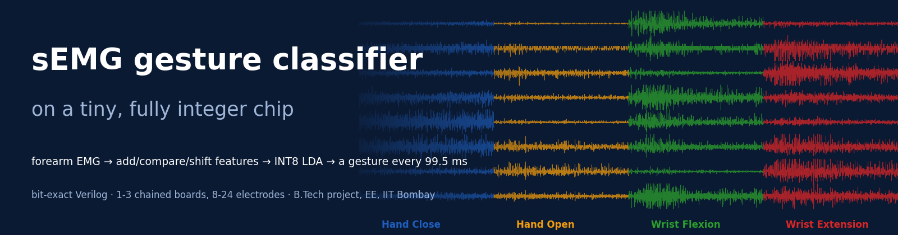
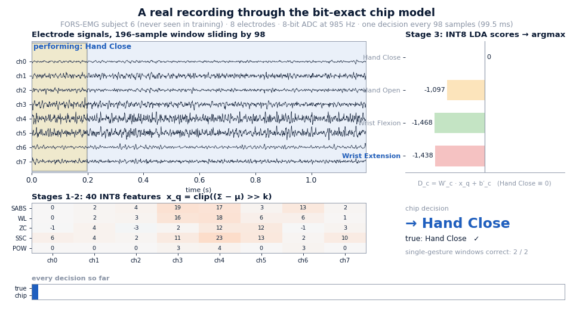
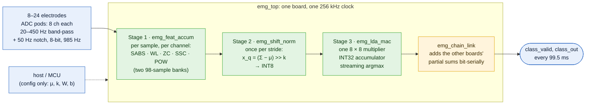
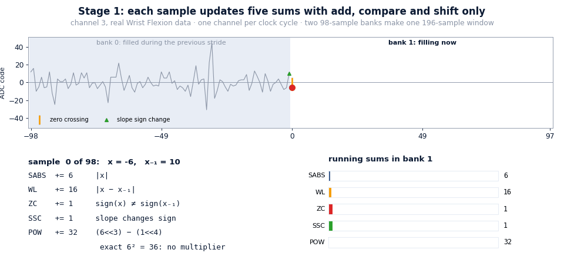
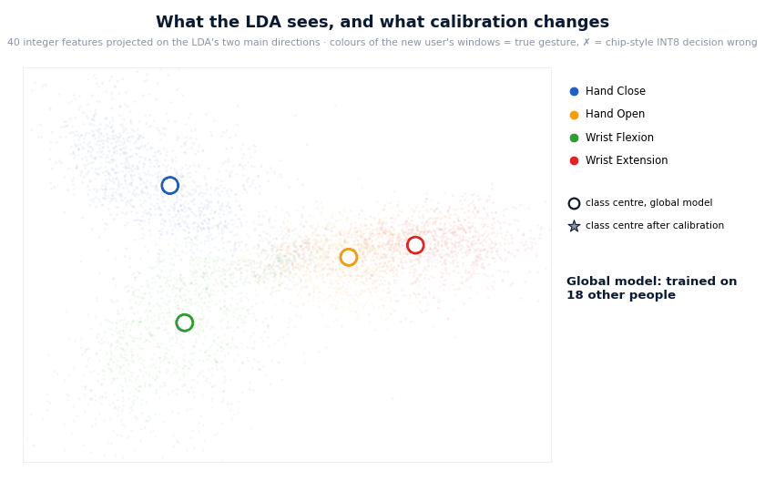
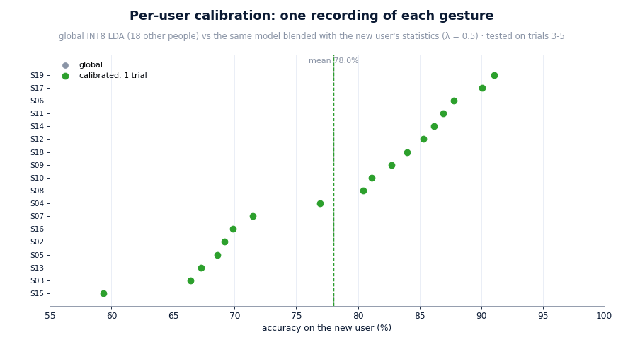
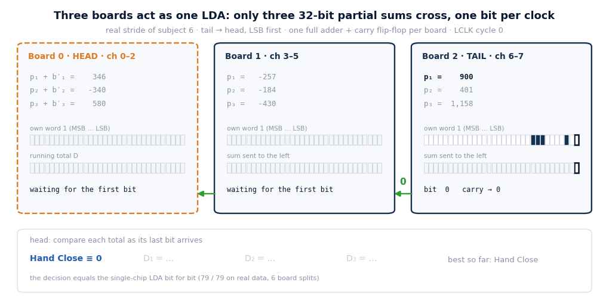

<p align="center">
  
</p>

<p align="center">
  
  
  
  
  
</p>

> **TL;DR.** A low-cost prosthetic hand has to read the wearer's forearm muscles on a tiny, cheap,
> low-power chip. We built that chip's digital core:
> - **8–24 surface-EMG electrodes in, one hand gesture out every 99.5 ms**;
> - features made from **add, compare and shift only**, and an **INT8 LDA with a single 8 × 8 multiplier**;
> - **77.6 %** on people the model has never seen (4 gestures, leave-one-subject-out on FORS-EMG), and
>   **86.4 %** after a one-minute calibration with one recording per gesture;
> - **bit-exact Verilog**, verified against a Python golden model, that splits across **1–3 chained boards**
>   with only 96 bits per decision passing between them.

B.Tech project, Department of Electrical Engineering, IIT Bombay (BioNICS group, advisor Prof. Laxmeesha Somappa).
Team: Vinay Hariharan, Sudhindra Sahoo, Yashvardhan Khandegar, Digvijay Kumbhar.

---

## 1 · The problem

When you make a fist, the muscles in your forearm fire, and electrodes on the skin pick up a noisy
electrical signal: **surface electromyography (sEMG)**. A prosthetic hand can use that signal to decide
which gesture the wearer wants. To be wearable and affordable, the decision has to be made:

- **in real time**: a new decision every ~100 ms;
- **on a small, fixed-function chip**: no floating point, almost no multipliers, a few kbit of memory;
- **for a new user**: the factory model is trained on other people, so we always test on a person
  the model has never seen (**leave-one-subject-out, LOSO**).

## 2 · A real recording through the chip

Below, a real 8-channel recording of a person who was **left out of training** is streamed through the
**bit-exact model of the chip**: the same integers the Verilog computes. Every 98 samples the chip turns
the last 196-sample window into 40 INT8 features, scores the 4 gestures and picks the largest score.

<p align="center"></p>

<sub>Data and model: [`RTL/tb/mb_data/`](RTL/tb/mb_data), the same stream the multi-board testbench runs
(subject 6, trial 1, 2 s of each gesture). The chip gets 72 of the 76 single-gesture windows right; the RTL
reproduces all 79 decisions bit for bit.</sub>

## 3 · The signal chain



| | |
|---|---|
| Window / stride | 196 / 98 samples (199 ms / 99.5 ms), ping-pong banks so no sample is stored |
| Features | 5 per channel, 40 for 8 channels: SABS (Σ\|x\|), WL (Σ\|Δx\|), ZC, SSC, POW (Mitchell Σx²) |
| Classifier | 4-class INT8 LDA in difference form: 3 rows × 40 = 120 MACs, one weight scale |
| Clock | one 256 kHz clock per board; decision ≈ 266 cycles (≈ 1 ms) after the stride's last sample |
| Memory | ≈ 3.6 kbit per board |

### Stage 1: features without a multiplier

Every sample, each channel updates five running sums. All of them need only **add, subtract, absolute
value, compare and shift**. The power term uses **Mitchell's approximation** of x²: find the leading one
of |x| at position p, then x² ≈ (|x| << (p+1)) − (1 << 2p). It is never too large and at most 25 % too
small, and the classifier does not mind (77.39 % against 77.45 % for the float reference).

<p align="center"></p>

<p align="center"></p>

### Stage 2 and 3: an integer normaliser and an INT8 LDA

The usual z-score `(x − mean) / std` needs a divider. Stage 2 replaces it with a subtract and an
arithmetic shift, `x_q = clip((Σ − μ + 2^(k−1)) >> k, −128, 127)`, with μ and k fitted on the training
people. Stage 3 is a **Linear Discriminant Analysis**: one dot product per class, done on a single
8 × 8 multiplier into an INT32 accumulator, and the largest score wins. In the 2-D picture below
(the LDA's two main directions) each gesture forms a cloud, and the LDA puts its boundaries between them.

## 4 · How the design was chosen

Every choice was made with a controlled, paired experiment: same 19 people, same windows, same folds,
Wilcoxon test per subject, 95 % confidence interval of the difference.

**The gesture set mattered most.** The first set (Hand Close, Hand Open, Index, Index + Little) stalled
at about 65 %: Index and Index + Little alone caused ~40 % of all errors, because they use overlapping deep
finger muscles. Choosing gestures that use different, superficial muscles (Hand Close, Hand Open, Wrist
Flexion, Wrist Extension) gained **+14.1 points (p = 3.8 × 10⁻⁹)**, more than any model change.
Merging all 12 gestures into 4 groups instead of dropping 8 was worse for all 19 people (60.9 % vs 77.8 %).

**Model capacity did not matter.** MLPs of five widths, logistic regression, linear SVM and LDA are
statistically tied; the trees that fit a 10 KB budget are worse. LDA won on hardware cost: closed-form
training, 160 MACs, 176 bytes.

<p align="center">
  
  
</p>

**A CNN on the raw signal was not worth it.** Two small CNNs (11.7–12.1 k parameters) reached
+1.3 points (not significant) and +2.7 points (p = 0.008) over the INT8 LDA, for **3,700–4,700 × the
arithmetic** (595–752 k MACs against 160). After per-user calibration the CNN's lead was +2.4 points,
below the agreed +3-point bar, at ≈ 870 × the arithmetic, so the LDA was kept.

**INT8 is free.** Over 28 FP32-vs-INT8 comparisons the average cost was **+0.18 points**.

## 5 · A new user: one-minute calibration

A model trained on other people works, but every arm is different: electrode position, skin, muscle size.
The fix is cheap for an LDA. Record **one repetition of each gesture** from the new user, blend the class
centres and the covariance with theirs (`μ ← (1 − λ) μ_global + λ μ_user`, λ = 0.5), and recompute W and b
in closed form. The chip does not change: only its weight registers are rewritten.

<p align="center"></p>

<sub>Subject 15, the hardest user, made with `analysis/K_4_LDA_Calib.py`'s own functions. The animation
trains on all 18 other subjects in this repository's copy of the dataset, so its numbers (60.8 → 90.0 %)
differ slightly from the logged run on 17 (59.3 → 89.5 %).</sub>

Across all users, calibration helps **every one of them**:

<p align="center"></p>

<sub>Numbers from [`docs/results/lda_calibration_18_subjects.txt`](docs/results/lda_calibration_18_subjects.txt):
78.0 → 86.4 %, +8.3 points [+4.4, +12.3], Wilcoxon p = 0.0002, 18 / 18 improve.</sub>

## 6 · Hardware: one board, or a chain of boards

The core on `main` is built to be chained. Each board is one `emg_top` with one 8-channel ADC pod;
1–3 boards act as one classifier for 8–24 electrodes.

<p align="center"></p>

**Why so little crosses between boards.** The LDA decision only needs the score *differences* to class 0.
Each board keeps the rows W′_c = W_c − W_0 for its own features and computes three partial sums
p₁, p₂, p₃. The totals D_c = Σ p_c decide: class = argmax{0, D₁, D₂, D₃}, exactly the single-chip answer.
So per decision only **three 32-bit numbers** travel, one bit per clock, least significant bit first, and
each board adds its own bit as they pass with **one full adder and a carry flip-flop**:

<p align="center"></p>

- **Synchronisation.** One 256 kHz clock for all boards. The head's `core_en` is passed down the chain
  (`run`), so every board's sample timer starts in the same cycle. A wired-AND ready line starts the
  transfer once every board has finished Stage 3.
- **Board roles** (head, middle, tail) and board ids are detected automatically from which neighbours are present.

<details>
<summary><b>Inside one board</b> (block diagram) and <b>one stride in simulation</b> (waveform)</summary>

<p align="center"></p>
<p align="center"></p>

</details>

## 7 · Verification

```bash
cd RTL
python3 tb/verify_all.py       # about 4 min, needs iverilog; prints ALL PASS or what failed
```

| Check | Result |
|---|---|
| `emg_chain_link` unit test, 1–4 boards, 3000 random strides each (large, small, negative and tied sums) | pass |
| Mutation test: 8 bugs planted one at a time (dropped carry, wrong tie-break, stale class, …) | 8 / 8 caught |
| Whole chip on real FORS-EMG, board splits 8 · 4+4 · 2+6 · 6+2 · 5+3 · 3+3+2 | 79 / 79 decisions bit-exact for every split |
| Golden model vs the original single-chip LDA | 79 / 79 equal |
| Bit-exact chip model vs software INT8 LDA, 18 new users | 77.61 % vs 77.83 %, no difference (p = 0.49) |

Raw output: [`docs/results/rtl_verify_all.txt`](docs/results/rtl_verify_all.txt). During development the
feature ALU was also checked exhaustively (all 196,608 input combinations), and the single-chip version passed
a cocotb chip test for 8, 12, 16, 20 and 24 channels.

## 8 · Headline results

All accuracies are leave-one-subject-out on FORS-EMG: the test subject is never seen in training.
Mean ± 95 % CI over subjects; "pp" = percentage points. Full write-up: [`docs/paper/BTP_paper.pdf`](docs/paper/BTP_paper.pdf).

| Question | Result |
|---|---|
| Which gestures? | Hand Close, Hand Open, Wrist Flexion, Wrist Extension: +14.1 pp over a hand + finger set (p = 3.8 × 10⁻⁹) |
| Merge all 12 gestures into 4 classes instead of dropping 8? | 60.9 % vs 77.8 %, worse on 19 / 19 subjects; the earlier 6-group map: 72.4 %, still −5.5 pp |
| Does model capacity help? | MLP, logistic regression, linear SVM and LDA statistically tied (77.9–79.6 %) |
| Does a raw-signal CNN help? | +1.3 pp (n.s.) and +2.7 pp (p = 0.008) for 3,700–4,700× the MACs (19 subjects) |
| INT8 cost | +0.18 pp on average over 28 comparisons |
| Integer front end (add, compare, shift) | 77.79 ± 4.39 % vs 77.88 % with float features |
| Bit-exact chip model on new users | 77.61 ± 4.34 % (18 subjects), no difference to the software INT8 LDA (p = 0.49) |
| Per-user calibration, one recording per gesture | LDA 78.0 → 86.4 % (+8.3 pp, 18 / 18 subjects improve) |
| Calibrated CNN vs calibrated LDA | +2.4 pp for 19 / 19 subjects, below the agreed +3 pp bar, at ≈ 870× the arithmetic: LDA kept |
| Multi-board RTL (8 ch per board, 256 kHz, 96 bits per decision between boards) | 79 / 79 decisions bit-exact on real data for 6 board splits; 8 / 8 planted bugs caught; 18 / 18 checks |

Details: [`docs/technical_summary.md`](docs/technical_summary.md) (model search) and [`RTL/README.md`](RTL/README.md) (hardware).

---

## Repository

```
.
├── analysis/                        software pipeline and model search (all on FORS-EMG, LOSO)
│   ├── K_4_LDA_Analysis.py          MAIN pipeline: loading, filtering, windowing, integer features, INT8 LDA
│   ├── K_4_LDA_HW_Experiments.py    choice of the multiplier-free feature set (H1-H6) and the shift normaliser
│   ├── fors_emg_feature_selection_lda.py  nested-LOSO feature-type selection
│   ├── classifier_classification.py 8-classifier comparison (linear, trees, MLP)
│   ├── K_4_model_MLP.py             INT8 MLP benchmark, 4 gestures
│   ├── K_6_model_LR_comparison.py   MLP vs Logistic Regression, best 6-gesture subset
│   ├── K_4_LDA_Merge_vs_Drop.py     all 12 gestures merged into 4 classes vs dropping 8 (chip LDA)
│   ├── K_4_LDA_Calib.py             LDA with per-user calibration
│   ├── K_4_CNN_LOSO.py              raw-signal CNNs vs INT8 LDA
│   └── K_4_CNN_Calib.py             CNN with per-user fine-tuning
├── golden_model/
│   ├── lda_golden_model.py          bit-exact Python model of the chip (Stages 1-3); training + test vectors
│   └── K_4_LDA_Golden_LOSO.py       chip model vs software LDA on FORS-EMG (paired LOSO)
├── RTL/                             Verilog of the chip + testbenches (see RTL/README.md)
├── docs/
│   ├── paper/                       the full paper: LaTeX source, figures, PDF (BTP_paper.pdf)
│   ├── presentation/                final slides (pptx + pdf) and the chronological waveform diagram
│   ├── readme/                      banner + animations of this page, and the script that makes them
│   ├── results/                     raw outputs of the scripts behind every number (see results/README.md)
│   ├── technical_summary.md         model search: preprocessing, INT8 scheme, results
│   ├── waveforms/                   simulated waveforms of the chip
│   └── report/                      earlier project report (single-chip version, LaTeX, figures, PDF)
└── archive/                         FORS-EMG dataset (Subject<i>/<orientation>/<gesture>-<trial>.mat)
```

<details open>
<summary><b>The Verilog modules</b> (<code>RTL/</code>)</summary>

| File | Stage | What it does |
|---|---|---|
| `emg_spi_adc.v` | — | CONVST timer, DRDY sync, SPI burst read of the ADC pod |
| `emg_feat_alu.v`, `emg_mitchell_sq.v` | 1 | per-sample \|x\|, \|Δx\|, zero crossing, slope sign change, Mitchell square |
| `emg_feat_accum.v` | 1 | running sums of every channel in two ping-pong banks; `stride_done` every 98 samples |
| `emg_shift_norm.v` | 2 | `clip(((Σ − μ) + 2^(k−1)) >>> k)` → INT8 `x_q` |
| `emg_lda_mac.v` | 3 | one signed 8 × 8 multiplier, INT32 accumulator, streaming argmax |
| `emg_chain_link.v` | — | head/tail detection, board id, common run, ready barrier, bit-serial adder, head argmax |
| `emg_core_ctrl.v`, `emg_cfg_regs.v` | — | sequencing and first-decision mask; writable μ, k, W, b and settings |
| `emg_top.v` | — | the chip top |

</details>

## Setup

```bash
pip install numpy scipy scikit-learn tabulate tqdm matplotlib   # every script
pip install torch                                                 # MLP and CNN scripts only
brew install icarus-verilog && pip install cocotb                 # RTL simulation (macOS; apt install iverilog on Linux)
```

Run every script from the repository root, for example `python analysis/K_4_LDA_Analysis.py`. The dataset is
found automatically in `archive/`; to use another copy, set `BASE_DIR` at the top of
`analysis/K_4_LDA_Analysis.py`. The scripts in `golden_model/` import their data loading from
`analysis/K_4_LDA_Analysis.py`, so every script sees the same filter, windows and folds.

To rebuild the banner and animations of this page:

```bash
python docs/readme/make_readme_figures.py        # about 2 min; "fast" skips the two that load the whole dataset
```

## Evaluation protocol (shared by every script)

- 20–450 Hz band-pass + 50 Hz notch, causal (as the hardware would run it).
- 200 ms windows (196–197 samples at 985 Hz), 100 ms stride.
- Leave-one-subject-out: the held-out subject is never seen in training, normalisation or calibration.
  Inside the training subjects, trial 5 is the validation set; trials 1–4 train.
- Windows are cut after the split, so overlapping windows never leak across it.
- Comparisons are paired per subject (Wilcoxon signed-rank test, 95 % CI of the paired difference).

## Development history

1. **Gesture set.** The original set {Hand Close, Hand Open, Index, Index Little} capped at about 65 %:
   Index ↔ Index Little alone caused about 40 % of errors. Switching to Hand Close, Hand Open, Wrist
   Flexion, Wrist Extension gained +14.1 pp (p = 3.8 × 10⁻⁹). Larger vocabularies: 6 gestures 69.0 %, 12 gestures 48.8 %.
   Merging all 12 gestures into 4 classes of 3 instead of dropping 8 (grouping chosen from the training
   subjects) gives 60.9 % against 77.8 %, worse on all 19 subjects, so gestures are dropped.
2. **Model.** Capacity is not the bottleneck: five MLP widths, Logistic Regression and LDA are
   statistically tied; trees that fit the 10 KB budget are worse. LDA was chosen for the ASIC
   (closed-form training, 160 MACs, 176 B).
3. **Integer front end.** Features rebuilt from add, subtract, absolute value, compare, shift and a
   leading-one detector (SABS, WL, ZC, SSC, Mitchell-squared POW), with an integer `(x − μ) >> k`
   normaliser: no accuracy loss against the float reference.
4. **Hardware.** Scope fixed in Oct 2026 to an LDA-only fixed-function core (CNN/ISA work by Yash and
   Digvijay explored the programmable alternative). Extensible mother–daughter design: one compute
   core, 1–3 daisy-chained 8-channel ADC pods (8–24 electrodes) set by one register.
5. **Verification.** A bit-exact golden model (`golden_model/lda_golden_model.py`) drives exhaustive unit tests and a
   chip-level testbench; the chip reproduces the golden model's decisions bit for bit.

## Branches

- `main`: the chained multi-board version described above.
- `single_chip`: the earlier single-board LDA chip (two clocks, 1 MHz core, up to 24 channels on one
  core, cocotb chip test). This was `main` until 12 Nov 2026.
- `processor_flexibility`: the chip as a configurable feature front end for a microcontroller:
  on-chip LDA removed, real TI ADS1299 ADC interface, SPI slave link to an MCU, on-chip IIR filter,
  configurable windows, fault flags. See `LDAcore_with_proc/README.md` on that branch.

The full project report is in [`docs/report/`](docs/report/).

## Acknowledgements

BioNICS group, Department of Electrical Engineering, IIT Bombay, and Prof. Laxmeesha Somappa.
Data: the FORS-EMG dataset (19 subjects, 12 gestures, 3 forearm orientations, 8 channels at 985 Hz).
Mitchell's approximation: J. N. Mitchell, *Computer multiplication and division using binary logarithms*, IRE Trans. Electronic Computers, 1962.
